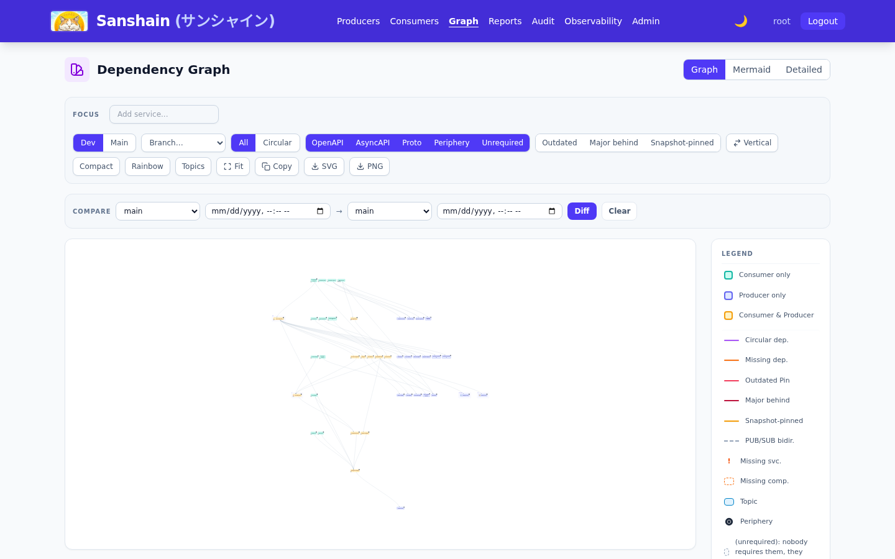

  

# [Sanshain Service](https://github.com/paxel/sanshain-service)

Sanshain (Japanese for "Sunshine") is a central repository to manage, split, and distribute API specifications. **Producers** provide their full API definitions; **Consumers** require only the specific snippets (endpoints, channels, or methods) they actually use at build time. A system is usually both.

### TL;DR
- **Centralized Specs**: Unified registry for OpenAPI, AsyncAPI, and gRPC/Proto.
- **Spec Splitting**: Clients download only the YAML snippets they need, avoiding massive dependency bloat.
- **Versioned, Pinned**: Producers publish immutable GA versions (or snapshots only their provider may overwrite); Consumers pin the exact version they build against. No fallback, no surprises.
- **Contract Safety**: A forgotten version bump or a breaking change hiding behind a minor bump is rejected at the door, with the correct next version proposed.
- **Live Graph**: Visualizes microservice dependencies in real-time, highlighting outdated and snapshot-pinned Consumers; Compact, Rainbow and Topics switches keep large graphs readable.
- **Client-First**: Designed for CI/CD automation with dedicated plugins.

---

## Core Features
- **Multi-Protocol**: Native support for OpenAPI, AsyncAPI, and Protocol Buffers.
- **Version Lines**: Each spec's version comes from the document itself (`info.version`; proto uses a `// sanshain-version:` comment) with a declared stability — `snapshot` or `ga`. GA permanently claims its number; elements marked deprecated may be removed. See [API Lifecycle](https://paxel.github.io/sanshain-service/developer/api-lifecycle.html).
- **Dependency Tracking**: Tracks exactly which Consumer pins which version of which endpoint.
- **Web Dashboard**: Navigate services, version timelines, diffs and dependencies visually.
- **Release Graphs**: A trunk ("main") stream and named sanshain-branches capture what production actually is — release cuts (retroactive if needed), a timeline over past graph states, structured graph diffs, and release-scoped reports (`?scope=main[@instant]` or `<branch>[@instant]`).
- **Periphery from Backstage**: A build can push its Backstage `catalog-info.yaml` (`PUT /catalog/{systemname}`, or `catalogInfo` in `sanshain.yaml`); the databases, buckets and queues its Component lists under `dependsOn` appear in the graph as Peripheral Resources, shared between the systems that use them, and travel into release cuts and diffs. The same file supplies the owner, description, links and tags shown on each node (a `tag:<name>` focus narrows the graph), fills an empty domain from `spec.system`, and draws `component:` refs that name no Sanshain system as missing components.
- **AsyncAPI payloads as OpenAPI**: An AsyncAPI requirement can ask for `format: openapi` and receive just its message payload schemas as an OpenAPI 3.0.3 document, ready for OpenAPI code generators. See [sanshain.yaml](https://paxel.github.io/sanshain-service/developer/sanshain-yaml.html#payload-schemas-as-openapi-format-openapi).
- **Free Spec Validator**: The landing page validates any OpenAPI, AsyncAPI or Protobuf spec against the exact rules a publish would face — no login, nothing stored.
- **Why a version changed**: Each provide may carry its origin — build URL, pull or merge request, ticket ids (linked through an admin-set URL template) and a one-line note. The clients fill the URLs from GitHub Actions, GitLab CI and Jenkins on their own; the version row, diff, blame, MCP and webhooks show it.
- **Auditing**: Full history of provides and administrative actions.
- **Backup**: On SQLite, a consistent database snapshot is one authenticated `GET` away — and a Helm CronJob fetches it nightly; PostgreSQL gets a `pg_dump` CronJob. Restore is documented for both. See [Backup and restore](https://paxel.github.io/sanshain-service/operator/backup.html).
- **Flexible Auth**: Local accounts, LDAP/Active Directory, or OpenID Connect SSO for human login; machine clients always use API tokens.
- **API Tokens with a Scope**: Each user mints their own tokens on the account page. A token is `full` (everything its owner may do) or `read_only` — for AI / MCP clients, it answers reports and versions but is refused on every route that changes the catalog. See [Using the API](https://paxel.github.io/sanshain-service/reference/api-usage.html#scopes-full-and-read-only).
- **Webhooks**: Signed outbound events — a Version published or deprecated, a Provide rejected, a new Consumer, a Sanshain-branch cut, a catalog push — to any URL on the admin's allow-list, as a JSON envelope or a ready-made Slack/Teams message; written with the fact in an outbox and retried for 24 hours. See [Webhooks](https://paxel.github.io/sanshain-service/operator/webhooks.html).
- **MCP for AI Assistants**: `/mcp` serves the catalog over the Model Context Protocol — list and describe services, find an endpoint, read a spec, walk the graph, diff and blame versions — behind a read-only API token, rate-limited and size-budgeted. See [MCP](https://paxel.github.io/sanshain-service/developer/mcp.html).

## Quick Start
1. **Launch**: `docker run -p 3000:3000 -v sanshain-data:/data ghcr.io/paxel/sanshain-service:latest`
2. **Setup**: Access `http://localhost:3000/admin.html` with the random password printed in the logs.
3. **Demo**: Run `./scripts/demo.sh` to populate the service with sample data.

Detailed instructions: [**Getting Started**](https://paxel.github.io/sanshain-service/start/getting-started.html).

## Documentation
The documentation is the site at **https://paxel.github.io/sanshain-service/**, in four tracks:
- [**Start**](https://paxel.github.io/sanshain-service/start/index.html) — run it in a few minutes, the concepts, the glossary.
- [**Developer**](https://paxel.github.io/sanshain-service/developer/index.html) — the web UI, `sanshain.yaml`, the clients, the API lifecycle, release graphs, CI integration, MCP.
- [**Operator**](https://paxel.github.io/sanshain-service/operator/index.html) — deployment, configuration, authentication, roles, administration, webhooks, backup, observability, troubleshooting.
- [**Reference**](https://paxel.github.io/sanshain-service/reference/index.html) — the REST and Maintenance contracts, the architecture, benchmarks, corporate best practices.

The root describes the latest release; every release since 2.6.1 stays under `/vX.Y.Z/` (for example [v2.7.0](https://paxel.github.io/sanshain-service/v2.7.0/)), and the version chip in the header switches between them.

Architecture decision records stay in the repository: [docs/adr](docs/adr/).

## Clients & Plugins
Integrate Sanshain directly into your build process:
- [**Maven Plugin**](https://github.com/paxel/sanshain-maven-plugin) — Java/Kotlin integration.
- [**Rust (Cargo)**](https://github.com/paxel/sanshain) — Subcommand for Rust microservices.
- [**Go CLI**](https://github.com/paxel/sanshain-go) — CLI and client for Go projects.
- [**JavaScript/TypeScript**](https://github.com/paxel/sanshain-js) — Node.js client, CLI, and GitHub Action.
- [**Conan Plugin**](https://github.com/paxel/sanshain-conan) — C/C++ dependency management for APIs.

## License
Apache-2.0 License. See [LICENSE](LICENSE).

## Changelog
See [CHANGELOG.md](CHANGELOG.md) for the latest updates.
