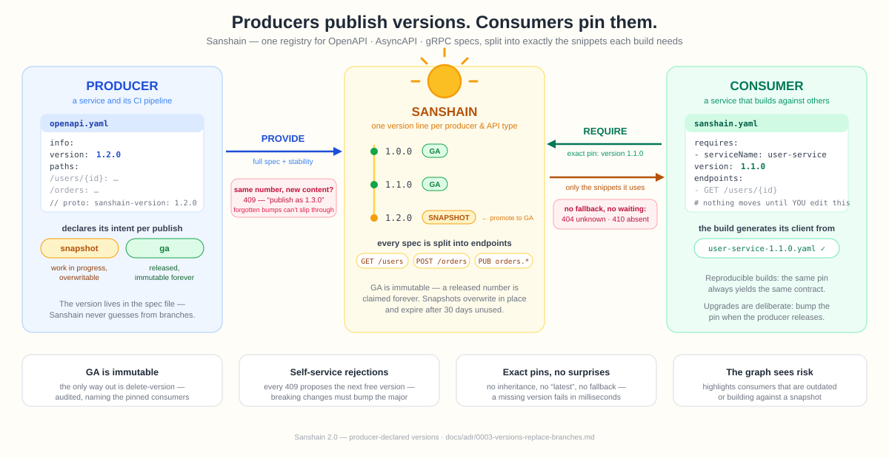
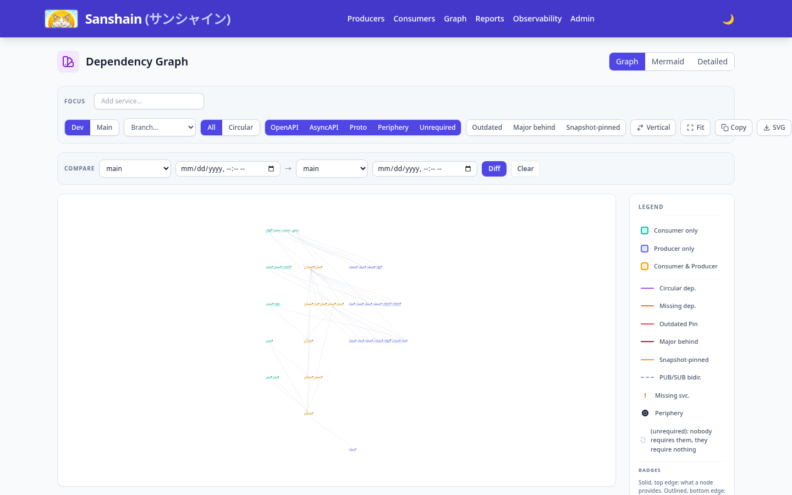

  

# [Sanshain Service](https://github.com/paxel/sanshain-service)

Sanshain (Japanese for "Sunshine") is a central repository to manage, split, and distribute API specifications. **Producers** provide their full API definitions; **Consumers** require only the specific snippets (endpoints, channels, or methods) they actually use at build time. A system is usually both.

### TL;DR
- **Centralized Specs**: Unified registry for OpenAPI, AsyncAPI, and gRPC/Proto.
- **Spec Splitting**: Clients download only the YAML snippets they need, avoiding massive dependency bloat.
- **Versioned, Pinned**: Producers publish immutable GA versions (or overwritable snapshots); Consumers pin the exact version they build against. No fallback, no surprises.
- **Contract Safety**: A forgotten version bump or a breaking change hiding behind a minor bump is rejected at the door, with the correct next version proposed.
- **Live Graph**: Visualizes microservice dependencies in real-time, highlighting outdated and snapshot-pinned Consumers.
- **Client-First**: Designed for CI/CD automation with dedicated plugins.

---

## Core Features
- **Multi-Protocol**: Native support for OpenAPI, AsyncAPI, and Protocol Buffers.
- **Version Lines**: Each spec's version comes from the document itself (`info.version`; proto uses a `// sanshain-version:` comment) with a declared stability — `snapshot` or `ga`. GA permanently claims its number; elements marked deprecated may be removed. See [API Lifecycle](docs/api-lifecycle.md).
- **Dependency Tracking**: Tracks exactly which Consumer pins which version of which endpoint.
- **Web Dashboard**: Navigate services, version timelines, diffs and dependencies visually.
- **Release Graphs**: A trunk ("main") stream and named sanshain-branches capture what production actually is — release cuts (retroactive if needed), a timeline over past graph states, structured graph diffs, and release-scoped reports (`?scope=main[@instant]` or `<branch>[@instant]`).
- **Periphery from Backstage**: A build can push its Backstage `catalog-info.yaml` (`PUT /catalog/{systemname}`, or `catalogInfo` in `sanshain.yaml`); the databases, buckets and queues its Component lists under `dependsOn` appear in the graph as Peripheral Resources, shared between the systems that use them, and travel into release cuts and diffs.
- **AsyncAPI payloads as OpenAPI**: An AsyncAPI requirement can ask for `format: openapi` and receive just its message payload schemas as an OpenAPI 3.0.3 document, ready for OpenAPI code generators. See [sanshain.yaml](docs/sanshain-yaml.md#payload-schemas-as-openapi-format-openapi).
- **Free Spec Validator**: The landing page validates any OpenAPI, AsyncAPI or Protobuf spec against the exact rules a publish would face — no login, nothing stored.
- **Auditing**: Full history of provides and administrative actions.
- **Flexible Auth**: Local accounts, LDAP/Active Directory, or OpenID Connect SSO for human login; machine clients always use API tokens.
- **API Tokens with a Scope**: Each user mints their own tokens on the account page. A token is `full` (everything its owner may do) or `read_only` — for AI / MCP clients, it answers reports and versions but is refused on every route that changes the catalog. See [API Usage](docs/api-usage.md#api-tokens).
- **MCP for AI Assistants**: `/mcp` serves the catalog over the Model Context Protocol — list and describe services, find an endpoint, read a spec, walk the graph, diff and blame versions — behind a read-only API token, rate-limited and size-budgeted. See [MCP](docs/mcp.md).

## Quick Start
1. **Launch**: `docker run -p 3000:3000 -v sanshain-data:/data ghcr.io/paxel/sanshain-service:latest`
2. **Setup**: Access `http://localhost:3000/admin.html` with the random password printed in the logs.
3. **Demo**: Run `./demo.sh` to populate the service with sample data.

Detailed instructions: [**Getting Started**](docs/getting-started.md).

## Documentation
- [**User Guide**](docs/user-guide.md) — Day-to-day usage: providing and requiring APIs.
- [**Client Ecosystem**](docs/clients.md) — Detailed guide for Maven, Cargo, Go, JS, and Conan.
- [**API Lifecycle**](docs/api-lifecycle.md) — How to handle breaking changes and versioning.
- [**API Usage**](docs/api-usage.md) — Authentication and detailed endpoint reference.
- [**MCP**](docs/mcp.md) — Connecting AI assistants (Claude Code, Cursor, VS Code) to the catalog: token setup, the tools, limits.
- [**Administration**](docs/administration.md) — LDAP and OIDC (SSO) setup, version administration, and user management.
- [**Troubleshooting**](docs/troubleshooting.md) — Common issues and how to solve them.
- [**AI Migration**](docs/ai-migration.md) — Guide for using AI to migrate your services to Sanshain.
- [**Corporate Best Practices**](docs/corporate-best-practices.md) — Recommendations for enterprise usage.

## Clients & Plugins
Integrate Sanshain directly into your build process:
- [**Maven Plugin**](https://github.com/paxel/sanshain-maven-plugin) — Java/Kotlin integration.
- [**Rust (Cargo)**](https://github.com/paxel/sanshain) — Subcommand for Rust microservices.
- [**Go CLI**](https://github.com/paxel/sanshain-go) — CLI and client for Go projects.
- [**JavaScript/TypeScript**](https://github.com/paxel/sanshain-js) — Node.js client, CLI, and GitHub Action.
- [**Conan Plugin**](https://github.com/paxel/sanshain-conan) — C/C++ dependency management for APIs.

## License
Apache-2.0 License. See [LICENSE](LICENSE).

## Changelog
See [CHANGELOG.md](CHANGELOG.md) for the latest updates.
