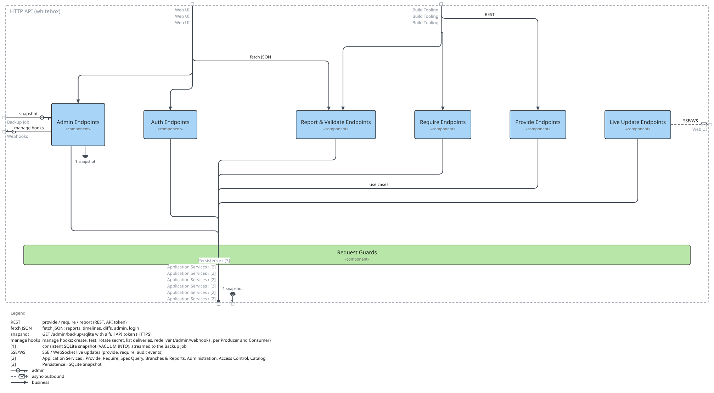

=== Whitebox HTTP API

==== Motivation

The endpoint groups follow the public REST surface documented in api.yaml: Build Tooling provides, requires, pushes catalog files and pulls reports; the Web UI uses reports, live updates, administration and login; the Backup Job uses one admin route with a full API token. Every group hands its work to the Application Services; the admin group also manages webhooks and streams the SQLite snapshot. Authentication, token scopes, permission guards, CSRF and observability apply to every request alike, so they are drawn as the Request Guards band rather than as a box every line passes through.

==== Contained building blocks

[options="header"]
|===
|Name |Responsibility

|Admin Endpoints
|/admin/* (handlers/admin.rs, roles.rs, webhooks.rs): producers, versions, promotion, diffs, branches, trunk graph and timelines, consumers, users, roles, groups, maintainers, settings, cleanup, observability, audit, webhooks in three scopes with the egress allow-list, and the SQLite snapshot download.

|Auth Endpoints
|/auth/login, /auth/oidc/login and callback, /auth/logout, /auth/register, /auth/me and /tokens (handlers/auth.rs): human login, sessions and API tokens with a full or read-only scope.

|Live Update Endpoints
|GET /api/sse/updates and /api/ws/updates, plus /api/audit/timeline (handlers/api.rs): push provide/require events to the dashboard and graph.

|Provide Endpoints
|POST /provide, /provide/asyncapi, /provide/grpc and PUT /catalog/\{systemname} (handlers/api.rs): a Producer publishes an OpenAPI, AsyncAPI or Protobuf spec version or its Backstage catalog-info.yaml.

|Report & Validate Endpoints
|GET /report, /report/markdown, /report/isolation and the anonymous POST /validate (handlers/api.rs): dependency reports and the free spec validator.

|Request Guards
|Cross-cutting request handling every endpoint passes (middleware.rs, lib.rs): API token (full or read-only scope) and session authentication, per-route permission guards, CSRF validation, CORS, compression, tracing and Prometheus layers feeding Telemetry, plus health/ready/metrics and HTML page routes.

|Require Endpoints
|GET /require, /require/asyncapi, /require/grpc, POST /require-bundle, GET /endpoint-versions and /producers/\{name}/versions (handlers/api.rs): a Consumer fetches pinned endpoint snippets and discovers versions.
|===

==== External interfaces

[options="header"]
|===
|Partner outside |Attached to |Direction |Text

|Build Tooling
|Provide Endpoints
|in
|provide / require / report (REST, API token)

|Build Tooling
|Require Endpoints
|in
|provide / require / report (REST, API token)

|Build Tooling
|Report & Validate Endpoints
|in
|provide / require / report (REST, API token)

|Web UI
|Report & Validate Endpoints
|in
|fetch JSON: reports, timelines, diffs, admin, login

|Web UI
|Admin Endpoints
|in
|fetch JSON: reports, timelines, diffs, admin, login

|Web UI
|Auth Endpoints
|in
|fetch JSON: reports, timelines, diffs, admin, login

|Application Services › Provide, Require, Spec Query, Branches & Reports, Administration, Access Control, Catalog
|Provide Endpoints
|out
|use cases

|Application Services › Provide, Require, Spec Query, Branches & Reports, Administration, Access Control, Catalog
|Require Endpoints
|out
|use cases

|Application Services › Provide, Require, Spec Query, Branches & Reports, Administration, Access Control, Catalog
|Report & Validate Endpoints
|out
|use cases

|Application Services › Provide, Require, Spec Query, Branches & Reports, Administration, Access Control, Catalog
|Live Update Endpoints
|out
|use cases

|Application Services › Provide, Require, Spec Query, Branches & Reports, Administration, Access Control, Catalog
|Admin Endpoints
|out
|use cases

|Application Services › Provide, Require, Spec Query, Branches & Reports, Administration, Access Control, Catalog
|Auth Endpoints
|out
|use cases

|Backup Job
|Admin Endpoints
|in
|GET /admin/backup/sqlite with a full API token (HTTPS)

|Webhooks
|Admin Endpoints
|out
|manage hooks: create, test, rotate secret, list deliveries, redeliver (/admin/webhooks, per Producer and Consumer)

|Persistence › SQLite Snapshot
|Admin Endpoints
|out
|consistent SQLite snapshot (VACUUM INTO), streamed to the Backup Job

|Web UI
|Live Update Endpoints
|out
|SSE / WebSocket live updates (provide, require, audit events)
|===

