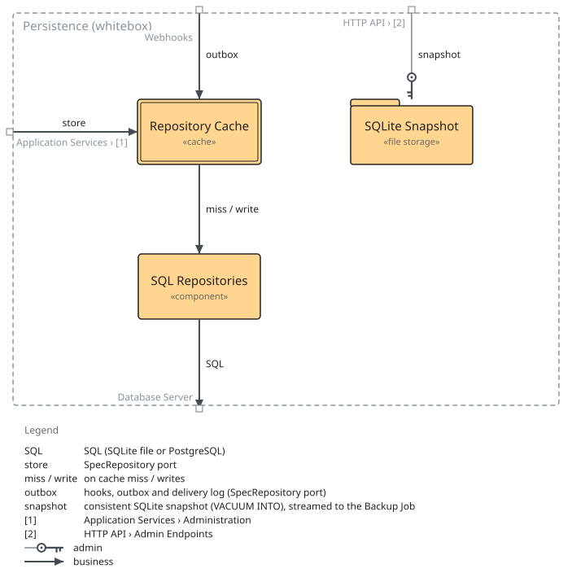

=== Whitebox Persistence

==== Motivation

The cache is a decorator over the same port the SQL repositories implement, so the use cases never know whether a read came from memory or the database; cached data expires after 10 seconds, so a second instance sees changes without a shared cache. The backend is chosen at startup. The snapshot bypasses the port on purpose: it is a file-level copy made by the SQLite engine, not a query.

==== Contained building blocks

[options="header"]
|===
|Name |Responsibility

|Repository Cache
|Moka-based caching decorator around the SpecRepository port (src/infrastructure/cached_repository.rs); configurable and clearable from the admin settings.

|SQL Repositories
|sqlx implementations of SpecRepository for SQLite and PostgreSQL plus schema migrations (src/infrastructure/sqlite_repository.rs, postgres_repository.rs, database.rs, migrations).

|SQLite Snapshot
|Consistent copy of the SQLite database made by the engine itself with VACUUM INTO (src/infrastructure/sqlite_snapshot.rs): one snapshot at a time, written to a temporary file next to the database, streamed to the caller and removed afterwards. PostgreSQL instances refuse the download and point to pg_dump.
|===

==== External interfaces

[options="header"]
|===
|Partner outside |Attached to |Direction |Text

|Database Server
|SQL Repositories
|out
|SQL (SQLite file or PostgreSQL)

|Application Services › Administration
|Repository Cache
|in
|SpecRepository port

|Webhooks
|Repository Cache
|in
|hooks, outbox and delivery log (SpecRepository port)

|HTTP API › Admin Endpoints
|SQLite Snapshot
|in
|consistent SQLite snapshot (VACUUM INTO), streamed to the Backup Job
|===

==== Internal relations

[options="header"]
|===
|From |To |Direction |Text

|Repository Cache
|SQL Repositories
|out
|on cache miss / writes
|===

