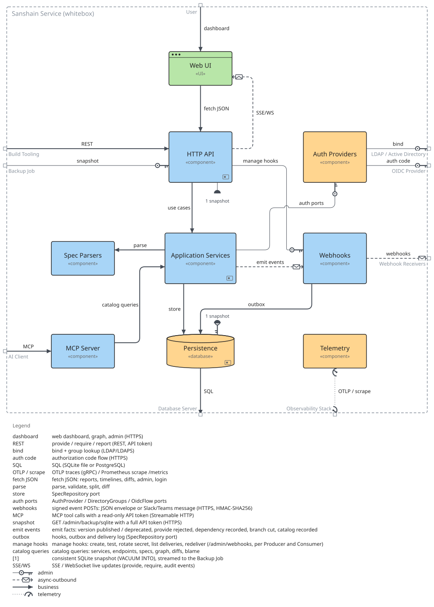

=== Whitebox Sanshain Service

==== Motivation

Hexagonal layering: the HTTP API and the MCP Server translate requests into use cases; Application Services hold the business rules and depend on traits in the domain layer (models, permissions, ports - shared by every box, so not drawn). Infrastructure adapters implement those ports: Auth Providers for human login and Persistence for storage. Spec parsing is kept apart from the use cases so that the free validator and the publish path apply identical rules. Webhooks are their own flow: the use cases write events into an outbox in the same transaction as the fact, and a background worker delivers them, so a slow receiver never slows a provide. Telemetry is fed by middleware layers on every request rather than by explicit calls. Line kinds: business (catalog flows), admin (operation and login), telemetry (traces, metrics), async-outbound (pushes that leave the request).

==== Contained building blocks

[options="header"]
|===
|Name |Responsibility

|Application Services
|Use cases (src/application): provide and require specs, version-line rules, release branches and graph timelines, Backstage catalog context, reports, administration, authentication with token scopes and permission checks, and the MCP catalog answers. Depends only on domain ports.

|Auth Providers
|Adapters for human login (src/infrastructure/*_provider.rs, tls.rs): local Argon2 accounts, LDAP/AD bind and group lookup with connect and operation timeouts, and the OIDC authorization code flow.

|HTTP API
|Axum router, handlers and middleware (src/presentation, src/lib.rs): REST endpoints for provide/require/catalog/report/admin/auth, token and session authentication with full or read-only token scope, permission guards per route, SSE/WebSocket live updates, webhook management and the /metrics endpoint.

|MCP Server
|Model Context Protocol endpoint for AI clients (src/presentation/mcp.rs, src/application/mcp_service.rs, docs/mcp.md): POST /mcp, Streamable HTTP, stateless, behind a read-only API token; tools list_services, describe_service, find_endpoint, get_spec, get_graph, diff_versions and blame answer from the catalog only, rate-limited per token and size-budgeted per answer.

|Persistence
|Implements the SpecRepository port: a Moka cache with a 10 s data TTL in front of interchangeable sqlx repositories for SQLite and PostgreSQL, including schema migrations, the webhook outbox tables and the SQLite snapshot.

|Spec Parsers
|OpenAPI, AsyncAPI and Protobuf handling (src/openapi.rs, src/asyncapi.rs, src/proto.rs): validate documents, extract version and endpoints, cut endpoint snippets and detect breaking changes.

|Telemetry
|OpenTelemetry tracer with OTLP exporter (src/infrastructure/telemetry.rs) and the Prometheus recorder behind /metrics; fed by the tracing and metric layers of every request.

|Web UI
|Browser dashboard (static/*.html, static/js, askama templates): producers, consumers, version timelines, diffs, dependency graph with peripheral resources and catalog context, reports, audit, observability, webhook and admin pages, account page with API tokens, plus the anonymous spec validator.

|Webhooks
|Outbound events (src/application/webhook_service.rs, webhook_delivery.rs, src/infrastructure/webhook_sender.rs, ADR-0009): decides which hooks a fact reaches (global hooks plus the hooks of the Producer and of its Consumers along the require graph), writes the deliveries to the outbox with the fact, and a worker claims due deliveries, renders JSON, Slack or Teams bodies, signs them with HMAC-SHA256 and POSTs them with backoff for 24 hours; egress is limited to the admin's host allow-list.
|===

==== External interfaces

[options="header"]
|===
|Partner outside |Attached to |Direction |Text

|User
|Web UI
|in
|web dashboard, graph, admin (HTTPS)

|Build Tooling
|HTTP API
|in
|provide / require / report (REST, API token)

|LDAP / Active Directory
|Auth Providers
|out
|bind {plus} group lookup (LDAP/LDAPS)

|OIDC Provider
|Auth Providers
|out
|authorization code flow (HTTPS)

|Database Server
|Persistence
|out
|SQL (SQLite file or PostgreSQL)

|Observability Stack
|Telemetry
|bi
|OTLP traces (gRPC) / Prometheus scrape /metrics

|Webhook Receivers
|Webhooks
|out
|signed event POSTs: JSON envelope or Slack/Teams message (HTTPS, HMAC-SHA256)

|AI Client
|MCP Server
|in
|MCP tool calls with a read-only API token (Streamable HTTP)

|Backup Job
|HTTP API
|in
|GET /admin/backup/sqlite with a full API token (HTTPS)
|===

==== Internal relations

[options="header"]
|===
|From |To |Direction |Text

|HTTP API
|Web UI
|in
|fetch JSON: reports, timelines, diffs, admin, login

|HTTP API
|Application Services
|out
|use cases

|Application Services
|Spec Parsers
|out
|parse, validate, split, diff

|Application Services
|Persistence
|out
|SpecRepository port

|Application Services
|Auth Providers
|out
|AuthProvider / DirectoryGroups / OidcFlow ports

|Application Services
|Webhooks
|out
|emit facts: version published / deprecated, provide rejected, dependency recorded, branch cut, catalog recorded

|Webhooks
|Persistence
|out
|hooks, outbox and delivery log (SpecRepository port)

|HTTP API
|Webhooks
|out
|manage hooks: create, test, rotate secret, list deliveries, redeliver (/admin/webhooks, per Producer and Consumer)

|MCP Server
|Application Services
|out
|catalog queries: services, endpoints, specs, graph, diffs, blame

|HTTP API
|Persistence
|out
|consistent SQLite snapshot (VACUUM INTO), streamed to the Backup Job

|HTTP API
|Web UI
|out
|SSE / WebSocket live updates (provide, require, audit events)
|===

